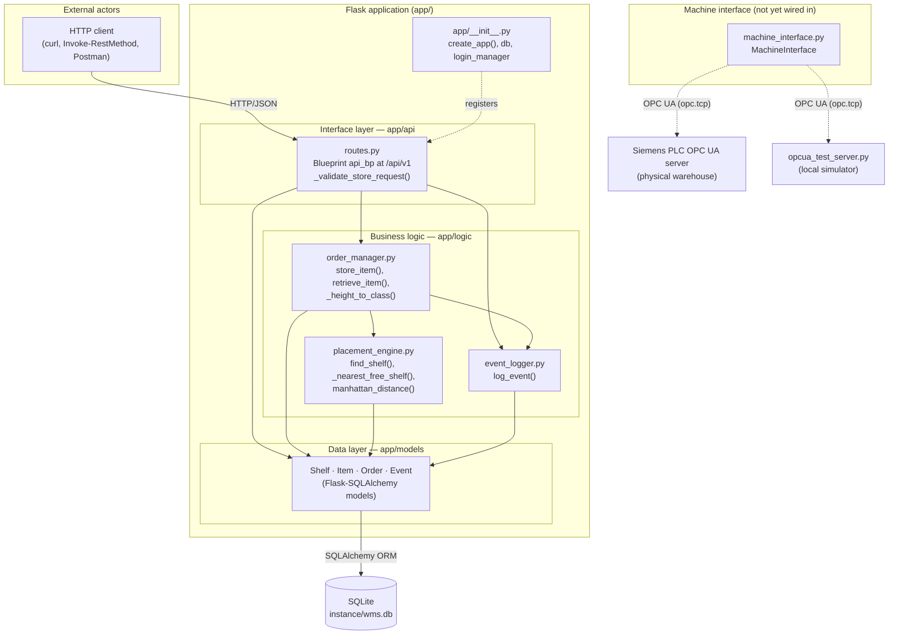
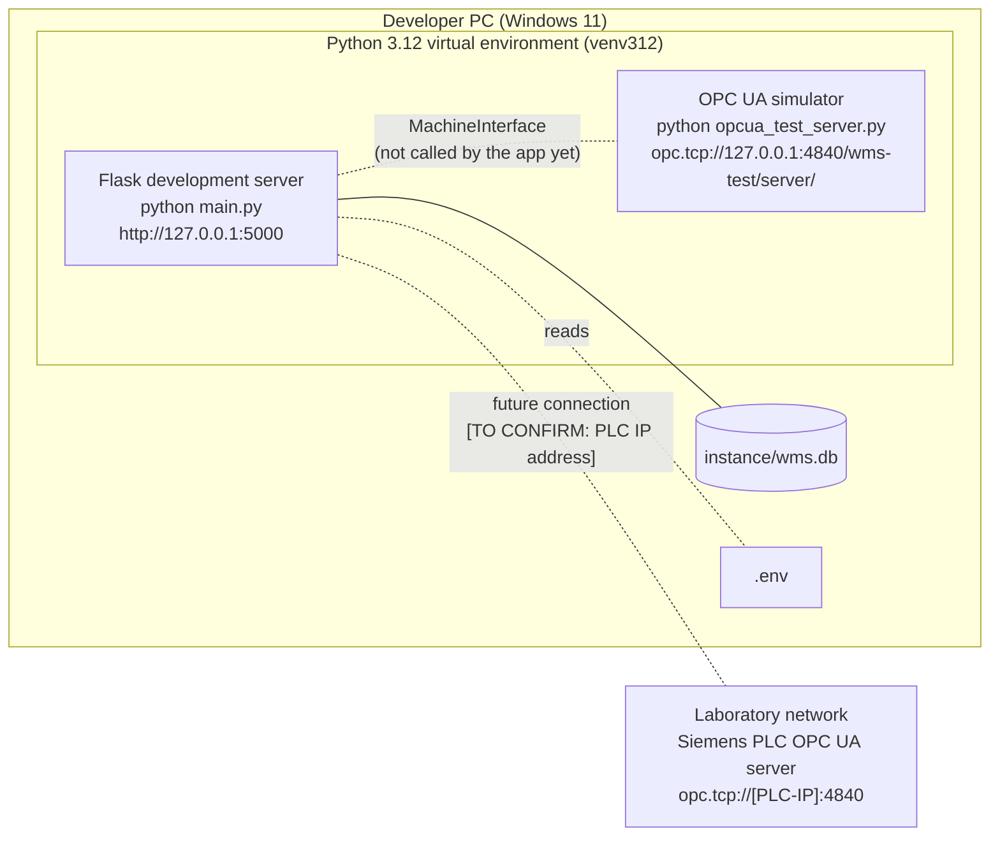
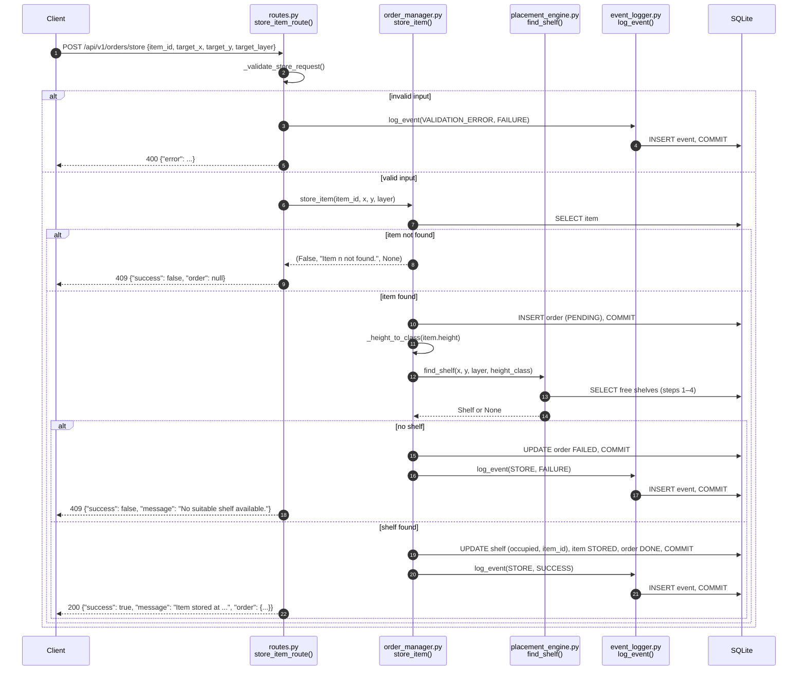
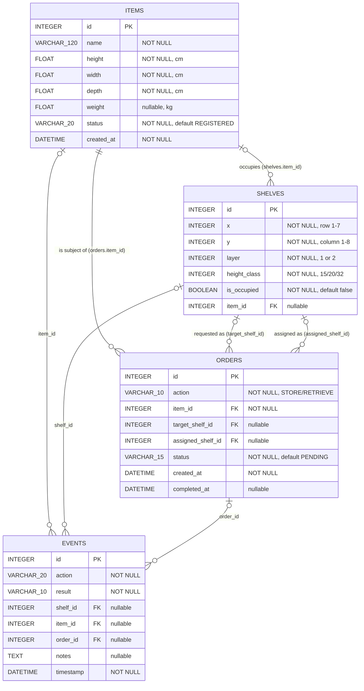
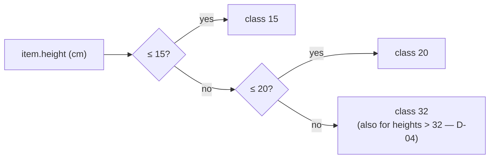
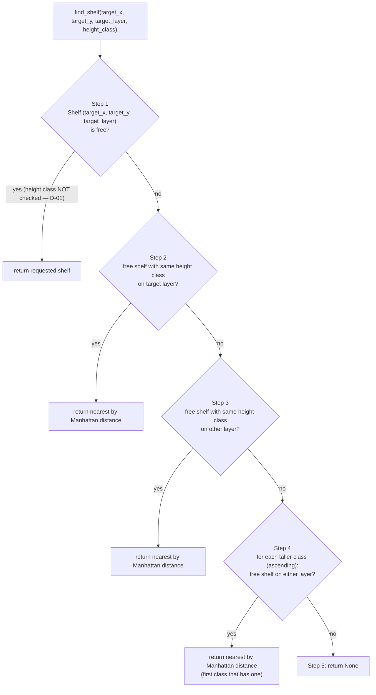
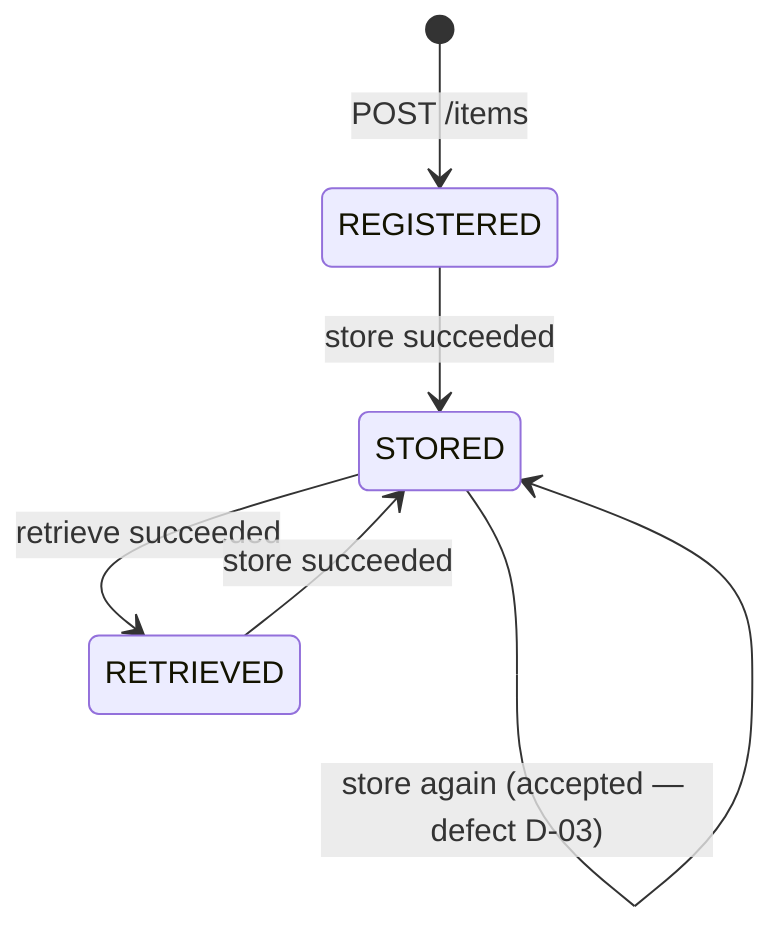
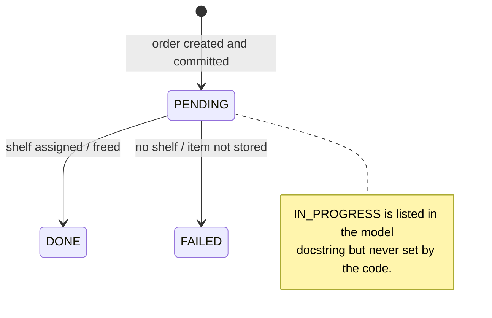

# Warehouse Management System (WMS) for the High-Bay Warehouse of the Digitale Fabrik

### Project Documentation

---

| | |
|---|---|
| **Project title** | Warehouse Management System (WMS) for a High-Bay Warehouse (Hochregallager) |
| **Author** | `[Your Name]` |
| **Matriculation number** | `[Matriculation Number]` |
| **Degree programme / course** | `[Course name — e.g. BCS Computer Science, 10-credit project; TO CONFIRM]` |
| **University** | `[University — TO CONFIRM; both reference theses are from Hochschule Emden/Leer]` |
| **Supervisor(s)** | `[Supervisor Name(s)]` |
| **Submission date** | `[Submission Date]` |
| **Document version** | 1.0 — describes the code base as of 21 October 2026 |
| **Repository** | `https://github.com/ishitadudhal/WarehouseManagement` (repository root = local folder `WMS/`) |

---

## Table of Contents

1. [Title Page](#warehouse-management-system-wms-for-the-high-bay-warehouse-of-the-digitale-fabrik)
2. [Abstract and Executive Summary](#2-abstract-and-executive-summary)
3. [Introduction](#3-introduction)
4. [Functional and Non-Functional Requirements](#4-functional-and-non-functional-requirements)
5. [Technology Stack and Development Environment](#5-technology-stack-and-development-environment)
6. [System Architecture](#6-system-architecture)
7. [Database Design](#7-database-design)
8. [Implementation of the Modules](#8-implementation-of-the-modules)
9. [Warehouse and Shelf-Management Logic](#9-warehouse-and-shelf-management-logic)
10. [User Workflows and Examples of Operation](#10-user-workflows-and-examples-of-operation)
11. [Installation, Configuration and Execution on Windows](#11-installation-configuration-and-execution-on-windows)
12. [Testing](#12-testing)
13. [Error Handling, Validation, Security and Data Integrity](#13-error-handling-validation-security-and-data-integrity)
14. [Limitations, Challenges and Future Improvements](#14-limitations-challenges-and-future-improvements)
15. [Conclusion](#15-conclusion)
16. [References and Appendices](#16-references-and-appendices)

### Conventions used in this document

| Marker | Meaning |
|---|---|
| **Implemented** | Present in the source code and observed working (see Chapter 12 for evidence). |
| **Partially implemented** | Present in the code, but incomplete or affected by a known defect. |
| **Not implemented** | Described in the project's design documents but absent from the code. |
| **Proposed** | A suggested improvement; not part of the current system. |
| `[TO CONFIRM: …]` | Information that cannot be established from the project files and must be confirmed by the author or the laboratory. |
| **D-nn** | Identifier of a known defect or discrepancy (catalogued in Section 12.6). |
| **TC-nn** | Identifier of a test case (Section 12.4). |

---

## 2. Abstract and Executive Summary

### 2.1 Abstract

This project implements the software back end of a Warehouse Management System (WMS) for the automated high-bay warehouse (*Hochregallager*) of the *Digitale Fabrik*, a laboratory production environment. The system maintains a digital representation of 112 shelf positions arranged in two layers of seven rows and eight columns, registers items with their physical dimensions, decides on which shelf an item is stored, and records every store and retrieve operation in an append-only audit log. Placement follows a five-step fallback strategy: the requested shelf is used if free; otherwise the nearest free shelf (by Manhattan distance) of the same height class is sought on the same layer, then on the other layer, and finally in taller height classes. The system is written in Python using the Flask web framework, persists its state in SQLite through Flask-SQLAlchemy, and exposes a REST API under `/api/v1`. A separate module provides an OPC UA client written against the node structure of the warehouse's Siemens PLC as documented by Ubben (2025); it has been exercised against a local OPC UA simulation server but is not yet connected to the order workflow or to the physical machine. A non-destructive test campaign of 36 test cases was executed for this report: 25 passed, 10 failed and 1 was blocked. The failures document known defects, most importantly that the requested shelf is used without checking its height class, that an item already in storage can be stored a second time, and that item registration does not validate dimensions.

### 2.2 Executive summary

| Aspect | Status |
|---|---|
| Data model (shelves, items, orders, events) | **Implemented** — four SQLAlchemy models, SQLite database `instance/wms.db`. |
| Shelf initialisation | **Implemented** — `seed_shelves.py` creates 112 shelves; idempotent (TC-01, TC-02). |
| REST API | **Implemented** — 6 endpoints (`GET /shelves`, `GET /items`, `POST /items`, `POST /orders/store`, `POST /orders/retrieve`, `GET /events`). |
| Placement engine | **Partially implemented** — fallback chain works (TC-12, TC-24 – TC-27), but step 1 ignores height class (D-01). |
| Order management | **Partially implemented** — store and retrieve work; no duplicate-store guard (D-03), no transactional rollback (D-06). |
| Audit log | **Implemented** — every store/retrieve outcome and every API validation error is logged. |
| Machine interface (OPC UA) | **Partially implemented** — stand-alone client; tested against a simulator only; not invoked by the order workflow (D-10). |
| Operator dashboard, login, overflow queue | **Not implemented** (described in the design documents). |
| Automated test suite | **Not implemented** — the tests in Chapter 12 were executed as a scripted manual campaign. |

The most important open issues before any connection to the physical warehouse are: correcting the height-class check (D-01), preventing double storage (D-03), validating item dimensions (D-04), making each operation atomic (D-06), modelling non-addressable shelf positions (D-08), and confirming the correct height-class layout (D-09).

---

## 3. Introduction

### 3.1 Background

**High-bay warehouses.** A high-bay warehouse is an automated storage system with discrete storage locations in tall racks, served by a storage and retrieval machine rather than by human operators. Ubben (2025), citing Virkus (2010), characterises such warehouses by their high storage density per floor area and by the fact that the decision *where* goods are stored is typically made by software, possibly according to criteria such as weight or the product currently being manufactured.

**The Digitale Fabrik warehouse.** The warehouse addressed by this project is part of the *Digitale Fabrik* in the Technikum of the E+I department at Hochschule Emden/Leer. Ubben (2025) describes its reconstruction and commissioning: the warehouse is controlled by a Siemens PLC and exposes an OPC UA server providing the basic functions *Einlagern* (store), *Auslagern* (retrieve) and *Referenzieren* (homing); a relocation function (*Umlagern*) was described but not implemented in that work. The physical layout used as the reference for this project is Figure 2.5 (*Layout des Hochregallagers in der Digitalen Fabrik*) of Virkus (2010), reproduced in the project folder as `WMS_Report/Reference Image.png`. It shows:

- a front view (*Frontansicht, Norden*) and a rear view (*Rückansicht, Süden*), each a grid of 7 rows × 8 columns;
- *addressable* (grey) and *non-addressable* (white) storage positions — the non-addressable positions are 12 positions on the front face, in rows 4–7 of the three columns adjacent to the I/O stations, leaving 100 addressable positions;
- two I/O stations, IO2 and IO3, at the bottom of the front face;
- height classes per row (see Section 9.1 and discrepancy D-09).

**Industry 4.0 and the Asset Administration Shell.** The project's design document (`System_Architecture.docx`, Section 2.4) frames each shelf record as the digital counterpart, or *Asset Administration Shell* (AAS, *Verwaltungsschale*), of a physical shelf. In the implementation this idea is realised informally: one row of the `shelves` table represents one physical storage position, and the REST API is the interface to read it. No AAS-standard serialisation or submodel structure is implemented.

### 3.2 Problem statement

The high-bay warehouse can execute store and retrieve operations at the PLC level, but there is no software layer that (a) knows which storage position holds which item, (b) decides where a new item should be stored, in particular when the requested position is already occupied, and (c) keeps a traceable record of what happened. Without such a layer, the state of the warehouse must be tracked manually and conflicts are not resolved systematically.

### 3.3 Motivation

The project's design documents identify three core problems a WMS must solve (`System_Architecture.docx`, Section 2.1): *assignment* (which shelf does a new item go to?), *conflict* (what if that shelf is taken?) and *visibility* (how does the operator know what the system did?). Providing a REST API additionally allows other components of the Digitale Fabrik, or test tools, to request storage operations programmatically.

### 3.4 Objectives

| ID | Objective | Status |
|---|---|---|
| O1 | Maintain a persistent digital model of all shelf positions, items, orders and events. | Implemented |
| O2 | Decide automatically on which shelf an item is stored, including a conflict-resolution strategy. | Partially implemented (D-01) |
| O3 | Record every system action in a permanent, append-only audit log. | Implemented |
| O4 | Expose the functionality through a REST API. | Implemented |
| O5 | Prepare the integration with the physical warehouse via OPC UA. | Partially implemented (stand-alone module, simulator-tested) |
| O6 | Provide an operator dashboard for monitoring. | Not implemented |

### 3.5 Scope

**In scope (implemented):** the back-end data model, shelf seeding, placement logic, store/retrieve order handling, event logging, REST API, an OPC UA client module and a local OPC UA simulation server for testing it.

**Out of scope of the current implementation** (but described in the design documents as planned): the operator dashboard (`templates/`, `static/` are empty), operator authentication, the overflow queue and queue processor, repository classes, PostgreSQL deployment, manual operator overrides, and alerting.

**Outside the project:** PLC programming, the mechanical and electrical warehouse, and the OPC UA server on the PLC (Ubben, 2025).

### 3.6 Requirements overview

The requirements were derived from the project's own design documents (`System_Architecture.docx`, `WMS_Architecture_Document_new.docx` Section 2.3 and Section 11) and from the README. They are listed, with their implementation status, in Chapter 4.

---

## 4. Functional and Non-Functional Requirements

### 4.1 Functional requirements

The *Source* column refers to the requirement identifiers R1–R12 of `WMS_Architecture_Document_new.docx`, Section 11, where applicable.

| ID | Requirement | Source | Status | Evidence / notes |
|---|---|---|---|---|
| FR-01 | Register an item with name, height, width, depth and optional weight. | Doc §5.1 | **Implemented** | `POST /api/v1/items`; TC-05. Dimension validation missing (FR-08). |
| FR-02 | List all shelves with their occupancy state. | Doc §5.1 | **Implemented** | `GET /api/v1/shelves`; TC-03. |
| FR-03 | List all registered items. | Doc §5.1 | **Implemented** | `GET /api/v1/items`; TC-04. |
| FR-04 | Accept a STORE order for an item with a target shelf (x, y, layer). | R1 | **Implemented** | `POST /api/v1/orders/store`; TC-10. The target is mandatory, not optional as in R1. |
| FR-05 | Automatically select an alternative shelf if the target is occupied. | R3 | **Implemented** | TC-12, TC-24, TC-25, TC-26. |
| FR-06 | Enforce height-class compatibility at placement time. | R9 | **Partially implemented** | Enforced in fallback steps 2–4 but not in step 1 (D-01; TC-14, TC-28). |
| FR-07 | Accept a RETRIEVE order by item ID. | R2 | **Implemented** | `POST /api/v1/orders/retrieve`; TC-21, TC-22. Retrieval by shelf coordinates (also R2) is **not implemented**. |
| FR-08 | Reject invalid input before it reaches the business logic (coordinates, layer, item dimensions). | R8; `System_Architecture.docx` §2.6 | **Partially implemented** | Coordinates and layer validated (TC-16 – TC-18); booleans accepted as integers (D-05, TC-19); item dimensions not validated (D-04, TC-07 – TC-09). |
| FR-09 | Reject storage of an item that is already stored. | Doc §6.1 step 1 | **Not implemented** | D-03; TC-13. |
| FR-10 | Record every action in a permanent audit log. | R5 | **Implemented** | `events` table; TC-16, TC-29. Item registration and "item not found" are not logged. |
| FR-11 | Report failure when no suitable shelf exists. | `System_Architecture.docx` §3.1 | **Implemented** | HTTP 409, order `FAILED`; TC-27. |
| FR-12 | Queue items when no shelf is available (overflow handling). | R4 | **Not implemented** | The system returns a failure instead (FR-11). |
| FR-13 | Operator dashboard with shelf grid and action history. | R6 | **Not implemented** | `templates/` empty; `static/js/` empty. |
| FR-14 | Prevent two concurrent orders from claiming the same shelf. | R10 | **Not implemented** | D-07. |
| FR-15 | Manual operator override of assignments. | R11 | **Not implemented** | — |
| FR-16 | Alert the operator when overflow occurs. | R12 | **Not implemented** | — |
| FR-17 | Exclude non-addressable shelf positions from placement. | Doc §2.2, §4.2 (`is_addressable`) | **Not implemented** | D-08. |
| FR-18 | Trigger store/retrieve operations on the physical warehouse via OPC UA, subject to safety checks. | README; `SoftwareArchitecture.pptx` | **Partially implemented** | `MachineInterface` exists and checks E-Stop/collision (TC-32, TC-33), but is not called by the order workflow (D-10) and cannot address a target position. |
| FR-19 | Query a single item, order or shelf; occupancy statistics (`/stats`). | Doc §5.1 | **Not implemented** | — |

### 4.2 Non-functional requirements

| ID | Quality attribute | Requirement | Status / assessment |
|---|---|---|---|
| NFR-01 | Maintainability | Separation of the system into interface, business-logic and data layers. | **Met** — `app/api`, `app/logic`, `app/models` are separate packages (Section 6.2). Repository classes from the design are not implemented; logic modules query the ORM directly. |
| NFR-02 | Portability | Database technology replaceable by configuration. | **Partially met** — the database URL is configurable (`DATABASE_URL`); only SQLite has been used. PostgreSQL has not been tested. |
| NFR-03 | Configurability | Secrets and environment-specific values outside the source code. | **Met** — `.env` via `python-dotenv`; `.env` is git-ignored. |
| NFR-04 | Traceability | Every action traceable after the fact. | **Largely met** — append-only by convention (no update/delete code paths); not enforced at database level. |
| NFR-05 | Data integrity / atomicity | An operation either completes fully or leaves no trace. | **Not met** — multiple commits per operation (D-06); SQLite foreign keys not enforced (D-15). |
| NFR-06 | Robustness | Invalid input must not crash the system. | **Not met** — a non-numeric height causes HTTP 500 (D-04, TC-08). |
| NFR-07 | Safety (machine) | No machine command while the machine is unsafe. | **Partially met** — E-Stop and collision checked (TC-32, TC-33); control-enabled flag not checked (D-12, TC-35). |
| NFR-08 | Security | Access to state-changing operations restricted to authorised users. | **Not met** — no authentication (Section 13.3). |
| NFR-09 | Performance | — | **Not specified and not measured.** No performance claims are made in this report. |
| NFR-10 | Testability | Automated, repeatable tests. | **Not met** — no test suite in the repository (Section 12.1). |
| NFR-11 | Usability | Operator can monitor the warehouse without technical tools. | **Not met** — no user interface; API only. |

---

## 5. Technology Stack and Development Environment

### 5.1 Technology stack

Versions are those installed in the project's virtual environment `venv312`, which was used for all tests in Chapter 12. Pinned versions in `requirements.txt` are shown where they differ.

| Layer | Technology | Version (installed) | Used for | Used in code? |
|---|---|---|---|---|
| Language | Python | 3.12.5 | All components | Yes |
| Web framework | Flask | 3.0.3 (with Werkzeug 3.1.8) | REST API, application factory, development server | Yes |
| ORM integration | Flask-SQLAlchemy | 3.1.1 | Models, session management | Yes |
| ORM | SQLAlchemy | 2.0.54 (not pinned in `requirements.txt`) | Query/persistence layer | Yes (via Flask-SQLAlchemy) |
| Database | SQLite | 3.45.3 (bundled with Python) | Persistent storage, file `instance/wms.db` | Yes |
| Configuration | python-dotenv | 1.0.1 | Loading `.env` | Yes |
| Machine interface | asyncua | 1.1.5 | OPC UA client (`asyncua.sync.Client`) and test server (`asyncua.Server`) | Yes |
| Authentication | Flask-Login | 0.6.3 | `LoginManager` is initialised | Initialised only; no login route or protected view exists (D-17) |
| Migrations | Flask-Migrate | 4.0.7 | — | **No** (listed in `requirements.txt` only) |
| Validation | marshmallow | 3.21.3 | — | **No** (validation is hand-written in `routes.py`) |

### 5.2 Development environment

| Item | Observed configuration |
|---|---|
| Operating system | Windows 11 |
| Project folder | `C:\Users\Ishit\Warehouse Project\WMS` (own Git repository) |
| Virtual environments | `venv312` (Python 3.12.5) and `venv` (Python 3.14.7). Both contain the required packages. The README names Python 3.14; all tests in this report used `venv312`. `[TO CONFIRM: which environment is the reference environment]` |
| Editor | VS Code workspace file `Warehouse Project.code-workspace` (opens the project folder and `../WMS_Report`). |
| Version control | Git; remote `origin` = `https://github.com/ishitadudhal/WarehouseManagement.git`; 5 commits dated 8–9 September 2026. At the time of writing the working tree contains uncommitted changes (Appendix B.3). |
| API testing tools | `curl` / PowerShell `Invoke-RestMethod` (README, `WMS_Command_Reference.pptx`); Postman is mentioned in the design documents. |

### 5.3 Justification of technology choices

The following rationale is taken from the author's design documents (`WMS_Architecture_Document_new.docx`, Sections 8.1, 8.2 and 1) and is presented here as the author's stated reasoning; where the implementation deviates, this is noted.

| Choice | Stated rationale | Remark on the implementation |
|---|---|---|
| Python | The author's strongest language; well suited to a data-driven system. | — |
| Flask instead of Django | Lighter; avoids working around Django's conventions; the missing parts (ORM, authentication) are covered by SQLAlchemy and Flask-Login. | Flask-Login is initialised but unused. |
| SQLite for development | No installation or configuration required; a single file. | SQLite is the only database used. |
| PostgreSQL for production | Proper concurrent writes and row-level locking. | **Not implemented.** The configurable URL makes a switch possible in principle. |
| REST API | Simple, stateless and easy to test with standard tools. | Implemented. |
| OPC UA (`asyncua`) | The laboratory PLC exposes an OPC UA server (Ubben, 2025). | `asyncua.sync` is used to offer a synchronous API that fits the synchronous Flask code. |
| Polling instead of WebSockets for the dashboard | Sufficient for warehouse update rates; simpler. | Dashboard not implemented. |

---

## 6. System Architecture

### 6.1 Architectural style

The system follows a layered architecture with an application-factory pattern. The README and `SoftwareArchitecture.pptx` describe the overall chain as:

> Operator → API / Dashboard → Business Logic → SQLite Database → OPC UA (Siemens PLC) → Physical Warehouse

In the implementation, the first four layers are connected; the dashboard does not exist, and the OPC UA layer is a stand-alone module that is not yet invoked by the business logic.

### 6.2 Component diagram



`routes.py` accesses the models directly for the read endpoints and for item registration, and calls `log_event()` directly for validation errors. All other database writes go through `order_manager.py`.

### 6.3 Component descriptions

| Component | File(s) | Responsibility |
|---|---|---|
| Entry point | `main.py` | Imports all models, builds the application with `create_app()`, starts the Flask development server on `127.0.0.1` and port `PORT` (default 5000). |
| Application factory | `app/__init__.py` | Loads `.env`, creates the `SQLAlchemy` and `LoginManager` extension objects, configures the app, registers the API blueprint under `/api/v1`, and calls `db.create_all()`. |
| REST API | `app/api/routes.py` | Six endpoints, input validation for store/retrieve, mapping of results to HTTP status codes. |
| Order Manager | `app/logic/order_manager.py` | Executes complete STORE and RETRIEVE operations: creates orders, calls the placement engine, updates shelves/items/orders, logs events. |
| Placement Engine | `app/logic/placement_engine.py` | Selects a shelf for an item using the five-step strategy (Section 9.3). |
| Event Logger | `app/logic/event_logger.py` | Appends one row to the `events` table per call and commits it. |
| Data models | `app/models/*.py` | ORM classes `Shelf`, `Item`, `Order`, `Event` with `to_dict()` serialisers. |
| Machine Interface | `app/logic/machine_interface.py` | OPC UA client for the PLC: connect/disconnect, safety checks, store/retrieve triggers. |
| Shelf seeding | `seed_shelves.py` | One-time creation of the 112 shelf rows. |
| OPC UA simulator | `opcua_test_server.py` | Local OPC UA server with the same `Lager` node hierarchy for testing the Machine Interface. |
| OPC UA smoke test | `test_server.py` | Seven-line script that exercises the Machine Interface against the simulator. |

### 6.4 Deployment view



The Flask server binds to `127.0.0.1` only (the default of `app.run()`), so it is not reachable from other machines.

### 6.5 Data flow — STORE operation



Note that one successful STORE issues three separate commits (order creation, state update, event); see D-06.

### 6.6 Data flow — RETRIEVE operation

```mermaid
sequenceDiagram
    autonumber
    participant C as Client
    participant R as routes.py<br/>retrieve_item_route()
    participant OM as order_manager.py<br/>retrieve_item()
    participant EL as event_logger.py
    participant DB as SQLite

    C->>R: POST /api/v1/orders/retrieve {item_id}
    alt item_id not an integer
        R->>EL: log_event(VALIDATION_ERROR, FAILURE)
        R-->>C: 400 {"error": ...}
    else
        R->>OM: retrieve_item(item_id)
        OM->>DB: SELECT item; SELECT first shelf WHERE item_id AND is_occupied
        OM->>DB: INSERT order (PENDING), COMMIT
        alt item not on any shelf
            OM->>DB: UPDATE order FAILED, COMMIT
            OM->>EL: log_event(RETRIEVE, FAILURE)
            R-->>C: 409 {"success": false, "message": "Item is not currently stored anywhere."}
        else
            OM->>DB: UPDATE shelf free, item RETRIEVED, order DONE, COMMIT
            OM->>EL: log_event(RETRIEVE, SUCCESS)
            R-->>C: 200 {"success": true, "message": "Item retrieved from ..."}
        end
    end
```

### 6.7 Traceability: design documents versus implementation

The design documents in `WMS_Report/` pre-date the implementation and describe a larger system. The table records the differences so that the reader does not mistake the design for the implementation.

| Design element (document, section) | Implementation |
|---|---|
| Five or six architectural layers including repository classes (`WMS_Architecture_Document_new.docx` §3) | No repository classes; logic modules use `Model.query` directly. |
| Folder layout `app.py`, `config.py`, `api/items.py`, `api/orders.py`, `repositories/`, `tests/` (§10) | `main.py`, `app/__init__.py`, single `app/api/routes.py`, no `repositories/`, no `tests/`. |
| Five tables including `queue` (§4) | Four tables; no `queue`. |
| `shelves.is_addressable`, `shelves.last_updated`, `orders.operator_id`, `items.description` (§4.2–4.4) | Not present. |
| Column names `shelf_id`, `x_position`, `height_cm`, `registered_at`, `action_type` … | `id`, `x`, `height`, `created_at`, `action` … |
| `x` = column (1–8), `y` = row (1–7) (`System_Architecture.docx` §2.6, §6.1) | `x` = row (1–7), `y` = column (1–8) (`Shelf` model, `routes.py`). |
| 200 shelf positions (several places) | 112 shelves (2 × 7 × 8). |
| Overflow handler and queue processor (§6.3, §6.4) | Not implemented; failure is returned. |
| Item status values `STORED / IN_TRANSIT / QUEUED / RETRIEVED` | `REGISTERED / STORED / RETRIEVED`. |
| Event actions `PLACED / RETRIEVED / ERROR …` | `STORE / RETRIEVE / VALIDATION_ERROR` (`PLACEMENT_FAILED` documented but never written). |
| marshmallow validation | Manual validation in `routes.py`. |
| Single transaction plus row-level lock per operation (§6.6) | Multiple commits; no locking (D-06, D-07). |
| Dashboard, Flask-Login, Bootstrap, Chart.js (§5.2) | Not implemented. |
| Error codes 400/404/409/503 (§5.1) | 400, 409 and (unhandled) 500 are produced; 404 and 503 are not used. |
| Command reference: `py -3.14 run.py`, OneDrive project path (`WMS_Command_Reference.pptx`) | Entry point is `main.py`; project path differs. |

---

## 7. Database Design

### 7.1 Overview and data-management approach

- **Engine:** SQLite, single file `instance/wms.db`.
- **Schema creation:** `db.create_all()` is called inside `create_app()`; it creates missing tables on every start but never alters existing ones. There are no migrations (Flask-Migrate is installed but not configured).
- **Initial data:** `seed_shelves.py` inserts the 112 shelves if, and only if, the `shelves` table is empty.
- **Access:** exclusively through the Flask-SQLAlchemy session (`db.session`) and the legacy `Model.query` interface.
- **Database location:** `DATABASE_URL=sqlite:///../instance/wms.db`. Flask-SQLAlchemy 3.x resolves relative SQLite paths against the application's instance folder (`WMS/instance`), so the URL resolves to `WMS/instance/wms.db`. An absolute path would be less ambiguous.
- **Version control:** the database file is excluded by `.gitignore` (`instance/`, `*.db`).
- **Constraint enforcement:** value domains (e.g. status values, coordinate ranges) are enforced only by application code. SQLite does not enforce foreign keys unless `PRAGMA foreign_keys=ON` is set per connection, which the project does not do; the historical event log contains an event referencing a non-existent item (Appendix E, event 8) — see D-15.
- **Timestamps:** stored in UTC via `datetime.utcnow`, as naive `DATETIME` values (no time-zone information).

### 7.2 Entity–relationship diagram



The relationship *item occupies shelf* is intended to be one-to-zero-or-one, but no `UNIQUE` constraint on `shelves.item_id` enforces this; defect D-03 has produced the "one item on two shelves" situation in practice (Appendix E).

### 7.3 Table definitions

The following DDL was read from `instance/wms.db` (`sqlite_master`) and is the schema actually in use.

```sql
CREATE TABLE items (
    id INTEGER NOT NULL,
    name VARCHAR(120) NOT NULL,
    height FLOAT NOT NULL,
    width FLOAT NOT NULL,
    depth FLOAT NOT NULL,
    weight FLOAT,
    status VARCHAR(20) NOT NULL,
    created_at DATETIME NOT NULL,
    PRIMARY KEY (id)
);

CREATE TABLE shelves (
    id INTEGER NOT NULL,
    x INTEGER NOT NULL,
    y INTEGER NOT NULL,
    layer INTEGER NOT NULL,
    height_class INTEGER NOT NULL,
    is_occupied BOOLEAN NOT NULL,
    item_id INTEGER,
    PRIMARY KEY (id),
    FOREIGN KEY(item_id) REFERENCES items (id)
);

CREATE TABLE orders (
    id INTEGER NOT NULL,
    action VARCHAR(10) NOT NULL,
    item_id INTEGER NOT NULL,
    target_shelf_id INTEGER,
    assigned_shelf_id INTEGER,
    status VARCHAR(15) NOT NULL,
    created_at DATETIME NOT NULL,
    completed_at DATETIME,
    PRIMARY KEY (id),
    FOREIGN KEY(item_id) REFERENCES items (id),
    FOREIGN KEY(target_shelf_id) REFERENCES shelves (id),
    FOREIGN KEY(assigned_shelf_id) REFERENCES shelves (id)
);

CREATE TABLE events (
    id INTEGER NOT NULL,
    action VARCHAR(20) NOT NULL,
    result VARCHAR(10) NOT NULL,
    shelf_id INTEGER,
    item_id INTEGER,
    order_id INTEGER,
    notes TEXT,
    timestamp DATETIME NOT NULL,
    PRIMARY KEY (id),
    FOREIGN KEY(shelf_id) REFERENCES shelves (id),
    FOREIGN KEY(item_id) REFERENCES items (id),
    FOREIGN KEY(order_id) REFERENCES orders (id)
);
```

Defaults such as `status='REGISTERED'` and `created_at=datetime.utcnow` are applied by SQLAlchemy on insert (Python-side defaults); they are not part of the DDL.

### 7.4 Entity descriptions

#### `shelves` — model `Shelf` (`app/models/shelves.py`)

One row per physical storage position. The class docstring describes it as the Administration Shell of the shelf.

| Column | Type | Meaning | Allowed values (application-level) |
|---|---|---|---|
| `id` | INTEGER PK | Shelf identifier. With the seeding order, `id = (layer − 1)·56 + (x − 1)·8 + y`. | 1–112 |
| `x` | INTEGER | Row | 1–7 |
| `y` | INTEGER | Column | 1–8 |
| `layer` | INTEGER | 1 = front/North, 2 = back/South | 1, 2 |
| `height_class` | INTEGER | Maximum item height in cm | 15, 20, 32 |
| `is_occupied` | BOOLEAN | Whether the position currently holds an item | — |
| `item_id` | INTEGER FK → `items.id` | Item on this shelf, or NULL | — |

ORM relationship: `Shelf.item` (with backref `Item.shelf`, a list).

#### `items` — model `Item` (`app/models/items.py`)

| Column | Type | Meaning |
|---|---|---|
| `id` | INTEGER PK | Item identifier |
| `name` | VARCHAR(120) | Human-readable name (not unique) |
| `height`, `width`, `depth` | FLOAT | Dimensions in cm |
| `weight` | FLOAT, nullable | Weight in kg |
| `status` | VARCHAR(20) | `REGISTERED`, `STORED`, `RETRIEVED` |
| `created_at` | DATETIME | Registration time (UTC) |

#### `orders` — model `Order` (`app/models/orders.py`)

| Column | Type | Meaning |
|---|---|---|
| `id` | INTEGER PK | Order identifier |
| `action` | VARCHAR(10) | `STORE` or `RETRIEVE` |
| `item_id` | INTEGER FK | Item concerned |
| `target_shelf_id` | INTEGER FK, nullable | Shelf requested by the client — **never populated** (D-02) |
| `assigned_shelf_id` | INTEGER FK, nullable | Shelf actually used (STORE) or freed (RETRIEVE) |
| `status` | VARCHAR(15) | `PENDING`, `DONE`, `FAILED` (`IN_PROGRESS` is documented but never set) |
| `created_at` | DATETIME | Creation time (UTC) |
| `completed_at` | DATETIME, nullable | **Never populated** (D-02) |

ORM relationships: `Order.item` (backref `Item.orders`), `Order.target_shelf`, `Order.assigned_shelf`.

#### `events` — model `Event` (`app/models/events.py`)

Append-only audit log. No code path updates or deletes events; this is a convention, not a database constraint.

| Column | Type | Meaning |
|---|---|---|
| `id` | INTEGER PK | Event identifier |
| `action` | VARCHAR(20) | `STORE`, `RETRIEVE`, `VALIDATION_ERROR` (values written by the code) |
| `result` | VARCHAR(10) | `SUCCESS` or `FAILURE` |
| `shelf_id`, `item_id`, `order_id` | INTEGER FK, nullable | References to the objects involved |
| `notes` | TEXT, nullable | Human-readable detail, e.g. `Stored at Layer 1, x=3, y=4` |
| `timestamp` | DATETIME | Time of the event (UTC) |

### 7.5 State of the project database at the time of writing

Read-only inspection of `instance/wms.db` on 21 October 2026: 112 shelves (32 × 15 cm, 48 × 20 cm, 32 × 32 cm), none occupied; 3 items; 6 orders; 18 events recorded between 10 and 21 September 2026 (Appendix E).

---

## 8. Implementation of the Modules

### 8.1 `main.py` — entry point

```python
from app import create_app
import app.models  # noqa: F401 — must be imported so db.create_all() sees all tables

flask_app = create_app()

if __name__ == '__main__':
    port = int(os.environ.get('PORT', 5000))
    debug = os.environ.get('FLASK_DEBUG', 'True') == 'True'
    flask_app.run(debug=debug, port=port)
```

The module-level `flask_app` object allows the application to be imported by other tools. Debug mode is enabled only when `FLASK_DEBUG` equals the exact string `True`, which is also the default when the variable is unset; any other value (including lower-case `true`) disables it.

### 8.2 `app/__init__.py` — application factory

- `load_dotenv()` runs at import time, before any configuration is read. Environment variables that are already set take precedence over `.env` (python-dotenv's default `override=False`).
- Module-level extension objects `db = SQLAlchemy()` and `login_manager = LoginManager()` are bound to the app in `create_app()` (`init_app`), the standard Flask extension pattern that avoids circular imports.
- Configuration keys: `SECRET_KEY` (fallback `dev-secret-key-change-me`), `SQLALCHEMY_DATABASE_URI` (fallback `sqlite:///../instance/wms.db`), `SQLALCHEMY_TRACK_MODIFICATIONS=False`, `DEBUG`.
- `login_manager.login_view = 'auth.login'` refers to a blueprint that does not exist; no `user_loader` is registered (D-17).
- The blueprint import is placed inside `create_app()` to avoid a circular import between `app` and `app.api.routes`.
- `db.create_all()` is executed inside an application context on every start.

### 8.3 `app/models/` — data models

Each model is a `db.Model` subclass with explicit `__tablename__`, a `__repr__` for debugging and a `to_dict()` method that produces the JSON representation used by the API (`datetime` values are converted with `isoformat()`). `app/models/__init__.py` imports all four classes so that importing any model module registers all tables with SQLAlchemy's metadata. Details are given in Section 7.4.

### 8.4 `app/api/routes.py` — REST API

A single blueprint `api_bp` is registered under the prefix `/api/v1`. Model and logic imports are performed inside the view functions (lazy imports), again to avoid circular imports at start-up.

| Method & path | View function | Request body | Responses |
|---|---|---|---|
| `GET /api/v1/shelves` | `get_shelves()` | — | 200: list of shelf objects |
| `GET /api/v1/items` | `get_items()` | — | 200: list of item objects |
| `POST /api/v1/items` | `create_item()` | `name`, `height`, `width`, `depth` (required), `weight` (optional) | 201: item; 400: missing field; 500: non-numeric dimension (D-04) |
| `POST /api/v1/orders/store` | `store_item_route()` | `item_id`, `target_x`, `target_y`, `target_layer` | 200: stored; 400: invalid input; 409: item not found or no shelf |
| `POST /api/v1/orders/retrieve` | `retrieve_item_route()` | `item_id` | 200: retrieved; 400: invalid input; 409: item not found or not stored |
| `GET /api/v1/events` | `get_events()` | — | 200: last 50 events, newest first |

**Validation constants:** `VALID_ROWS = range(1, 8)`, `VALID_COLS = range(1, 9)`, `VALID_LAYERS = (1, 2)`, `VALID_HEIGHT_CLASSES = (15, 20, 32)` (the last is defined but unused).

**`_validate_store_request(item_id, target_x, target_y, target_layer)`** returns the first applicable error message or `None`:

1. `item_id` must be an `int`;
2. `target_x` must be an `int` in 1–7;
3. `target_y` must be an `int` in 1–8;
4. `target_layer` must be in `(1, 2)`.

Because `bool` is a subclass of `int` in Python, JSON `true` passes checks 1–4 (D-05, TC-19). JSON bodies are read with `request.get_json(silent=True) or {}`, so a missing or malformed body results in a validation error rather than an exception.

### 8.5 `app/logic/order_manager.py` — Order Manager

**`store_item(item_id, target_x, target_y, target_layer)`** → `(success, message, order)`

1. Load the item with `Item.query.get(item_id)`; if absent, return `(False, 'Item … not found.', None)` without creating an order or event.
2. Create an `Order(action='STORE', status='PENDING')` and commit.
3. Compute `height_class = _height_to_class(item.height)`.
4. Call `find_shelf(target_x, target_y, target_layer, height_class)`.
5. If no shelf: set the order to `FAILED`, commit, log a `STORE/FAILURE` event, return `(False, 'No suitable shelf available.', order)`.
6. Otherwise: mark the shelf occupied and link the item, set the item to `STORED`, set `assigned_shelf_id` and status `DONE`, commit, log a `STORE/SUCCESS` event, return `(True, 'Item stored at Layer L, x=X, y=Y', order)`.

**`retrieve_item(item_id)`** → `(success, message, order)`

1. Load the item; if absent, return without order or event.
2. Find the first shelf with `item_id = item_id` and `is_occupied = True`.
3. Create a `RETRIEVE` order (PENDING) and commit.
4. If no shelf: order `FAILED`, log `RETRIEVE/FAILURE`.
5. Otherwise: free the shelf (`is_occupied=False`, `item_id=None`), set the item to `RETRIEVED`, order `DONE` with `assigned_shelf_id`, commit, log `RETRIEVE/SUCCESS`.

**`_height_to_class(height_cm)`** maps an item height to a height class by rounding up: ≤ 15 → 15; ≤ 20 → 20; otherwise → 32. Heights above 32 cm and non-positive heights are not rejected (D-04).

The module docstring states that "if anything fails partway through, everything is rolled back". The code does not implement this: there is no `try`/`rollback`, and each function performs three commits (D-06).

### 8.6 `app/logic/placement_engine.py` — Placement Engine

| Function | Purpose |
|---|---|
| `manhattan_distance(x1, y1, x2, y2)` | `abs(x1 − x2) + abs(y1 − y2)` |
| `find_shelf(target_x, target_y, target_layer, height_class)` | Five-step selection strategy (Section 9.3); returns a `Shelf` or `None`. |
| `_nearest_free_shelf(target_x, target_y, layer, height_class)` | Loads all free shelves of `height_class` (optionally restricted to `layer`) and returns the one with minimal Manhattan distance to the target, using Python's `min()`. |

`HEIGHT_CLASSES = [15, 20, 32]` defines the order in which taller classes are tried. The engine only reads; it does not modify shelves.

### 8.7 `app/logic/event_logger.py` — Event Logger

`log_event(action, result, shelf_id=None, item_id=None, order_id=None, notes=None)` creates one `Event`, adds it to the session and commits immediately, returning the event. Because it commits, any other pending changes in the same session are committed with it.

### 8.8 `app/logic/machine_interface.py` — Machine Interface (OPC UA)

The module targets the OPC UA server of the warehouse PLC as documented in Ubben (2025), Appendix B. Configuration:

- `ENDPOINT_URL` — from the environment variable `OPCUA_ENDPOINT_URL`, read **at import time**; fallback `opc.tcp://<PLC-IP-ADDRESS>:4840`.
- `NAMESPACE_URI = "http://TechnikumEID13.hsel.de"`.
- `NODE_PATHS` — browse paths of eight nodes below `Objects/Lager` (Appendix C).

Class `MachineInterface`:

| Method | Behaviour |
|---|---|
| `__init__(endpoint_url=ENDPOINT_URL)` | Stores the endpoint; no connection yet. |
| `connect()` | Creates an `asyncua.sync.Client`, connects, resolves the namespace index of `NAMESPACE_URI`. |
| `disconnect()` | Disconnects and clears the client and namespace index. |
| `_get_node(key)` | Translates the browse path from `NODE_PATHS` into `"<ns>:<name>"` elements (replacing the placeholder index `1`) and resolves it with `get_child()` from the Objects node. |
| `is_control_enabled()` | Reads `Steuerung Ein`. |
| `is_safe()` | Returns `False` if `Not Aus` (E-Stop) or `Kollisionen` (collision) is `True`. |
| `trigger_store()` / `trigger_retrieve()` | Raise `RuntimeError` if not safe; otherwise write `True` to `Einlagern` / `Auslagern`. |

Observations (see Section 12 and D-10 – D-13, D-21):

- The module is **not imported by any other application module**; store/retrieve orders do not reach the machine.
- The methods do not select a target position; the module docstring states that the position nodes are unknown.
- `trigger_*` does not check `is_control_enabled()` (TC-35) and does not reset the trigger to `False` (TC-34). Whether the PLC resets the trigger itself is `[TO CONFIRM]`.
- The docstring lists node names with underscores (`Steuerung_Ein`, `Not_Aus`), whereas `NODE_PATHS` and the simulator use spaces (`Steuerung Ein`, `Not Aus`). The names on the real PLC are `[TO CONFIRM with UaExpert]`.
- `Hand Automatik`, `Umlagern` and `Referenzieren` are defined in `NODE_PATHS` but have no methods. `Safety_IO` and `Wartungstür_offen` are documented but not mapped.
- When the module is run directly (`python app/logic/machine_interface.py`), `app/__init__.py` is not imported, so `.env` is not loaded and the placeholder endpoint is used unless `OPCUA_ENDPOINT_URL` is set in the shell (D-21; derived from code reading, not executed).

### 8.9 `seed_shelves.py`

Creates an application with `create_app()` (which also creates the tables), checks `Shelf.query.count()`, and if zero inserts shelves in the nested order layer 1–2 → row `x` 1–7 → column `y` 1–8, with `height_class = HEIGHT_CLASS[x]`:

```python
HEIGHT_CLASS = {1: 32, 2: 32, 3: 20, 4: 20, 5: 20, 6: 15, 7: 15}
```

The script's docstring says "200 shelf rows"; it actually creates 112 (TC-01).

### 8.10 `opcua_test_server.py` and `test_server.py`

`opcua_test_server.py` builds an `asyncua.Server` at `opc.tcp://127.0.0.1:4840/wms-test/server/` (overridable with `--endpoint` or `OPCUA_TEST_ENDPOINT`), registers `NAMESPACE_URI`, and creates the objects `Lager/Funktionen`, `Lager/Steuerung allgemein` and `Lager/Sicherheitsfunktionen` with eight writable Boolean variables. Initial values: control enabled and automatic mode `True`; E-Stop and collision `False`; all function triggers `False`.

`test_server.py` connects a `MachineInterface` to the simulator, prints the control and safety state, triggers store and retrieve, prints the trigger values and disconnects. It is a manual smoke test, not an automated test (it has no assertions).

---

## 9. Warehouse and Shelf-Management Logic

### 9.1 Warehouse model and coordinate system

| Property | Implementation |
|---|---|
| Layers | 2 — layer 1 = front/North face, layer 2 = back/South face |
| Rows per layer | 7 — attribute `x` |
| Columns per layer | 8 — attribute `y` |
| Shelves | 112, all usable by the software |
| Height classes | 15, 20, 32 cm, assigned per row |
| Shelf label used in messages | `Layer L, x=X, y=Y` |

**Height-class assignment: implementation versus reference figure (D-09).**

| Row | `seed_shelves.py` | Virkus (2010), Fig. 2.5 | Design documents |
|---|---|---|---|
| 1 | 32 cm | Höhenklasse 1 (32 cm) | 32 cm |
| 2 | 32 cm | Höhenklasse 2 (15 cm) | not stated |
| 3 | 20 cm | Höhenklasse 2 (15 cm) | 20 cm |
| 4 | 20 cm | Höhenklasse 2 (15 cm) | 20 cm |
| 5 | 20 cm | Höhenklasse 3 (20 cm) | 20 cm |
| 6 | 15 cm | Höhenklasse 3 (20 cm) | 15 cm |
| 7 | 15 cm | Höhenklasse 2 (15 cm) | 15 cm |

`[TO CONFIRM: which assignment matches the physical warehouse]`. If the figure is correct, the seeded data would permit, for example, a 20 cm item on a 15 cm row.

**Addressability (D-08).** The reference figure marks 12 front-face positions as non-addressable (rows 4–7 in the three columns next to IO2/IO3). The implementation has no `is_addressable` attribute and can assign these positions.

**Axis naming.** The code uses `x` for the row and `y` for the column, whereas the figure and the design documents use `x` for the column and a vertical axis (`z` in the figure, `y` in the documents) for the row. In the figure, front-view columns are numbered right-to-left. `[TO CONFIRM: mapping between software coordinates and PLC coordinates]`.

### 9.2 Height-class matching



An item fits any shelf whose height class is greater than or equal to its own class.

### 9.3 Placement algorithm



Characteristics, derived from the code and confirmed by tests where indicated:

- **Distance metric:** Manhattan distance between (row, column) indices, `|x₁ − x₂| + |y₁ − y₂|`. It measures distance from the *requested position*, not from the I/O stations, and ignores the layer.
- **Tie-breaking:** `min()` returns the first candidate with minimal distance in query order. The query has no `ORDER BY`; with SQLite this was observed to be ascending `id` (TC-12: among three candidates at distance 1, the shelf at x=3, y=3 was chosen). This order is not guaranteed by SQL.
- **Layer preference:** steps 2 and 3 prefer the requested layer; step 4 searches both layers together.
- **Cost:** each search step loads all free shelves of one class (at most 112 rows) and scans them in Python; no performance measurements were taken.
- **Defect D-01:** step 1 accepts the requested shelf regardless of its height class (TC-14: a 30 cm item was placed on a 15 cm shelf; TC-28: the same occurs even when no 32 cm shelf is free, instead of a rejection).

### 9.4 Worked example (from an actual run)

A fresh database was seeded and two items were registered: *Box A* (18 cm → class 20) and *Box B* (12 cm → class 15). Both were requested at layer 1, x = 3, y = 4 (a 20 cm shelf, id 20).

1. *Box A*: step 1 finds shelf (3, 4, 1) free → stored there (shelf id 20).
2. *Box B*: step 1 fails (occupied). Step 2 searches free class-15 shelves on layer 1, i.e. rows 6–7. The nearest to (3, 4) is (6, 4) with distance |3 − 6| + |4 − 4| = 3 → stored at x = 6, y = 4 (shelf id 44).

The responses are reproduced in Section 10.3.

### 9.5 Storage, retrieval and inventory workflows

**Item life cycle**



**Order life cycle**



**Inventory view.** There is no dedicated inventory or statistics endpoint. The current inventory is obtained from `GET /api/v1/shelves` (occupied shelves and their `item_id`) together with `GET /api/v1/items` (status per item). Item history can be reconstructed from `GET /api/v1/events`, which is limited to the latest 50 events.

**Consequence of D-03 for retrieval (derived from code).** If an item occupies two shelves, `retrieve_item()` frees only the first matching shelf and sets the item to `RETRIEVED`; the second shelf remains occupied by an item whose status says it has left the warehouse.

---

## 10. User Workflows and Examples of Operation

All examples in this chapter are actual responses, captured on 21 October 2026 from a freshly seeded test database (not the project database). Flask serialises JSON with keys in alphabetical order. Timestamps are UTC.

### 10.1 Workflow overview


### 10.2 Register an item

```http
POST /api/v1/items
Content-Type: application/json

{"name": "Box A", "height": 18, "width": 20, "depth": 20, "weight": 3.5}
```

Response `201 Created`:

```json
{
  "created_at": "2026-10-21T14:56:03.078961",
  "depth": 20.0,
  "height": 18.0,
  "id": 1,
  "name": "Box A",
  "status": "REGISTERED",
  "weight": 3.5,
  "width": 20.0
}
```

### 10.3 Store an item

Request at a free shelf:

```http
POST /api/v1/orders/store
Content-Type: application/json

{"item_id": 1, "target_x": 3, "target_y": 4, "target_layer": 1}
```

Response `200 OK`:

```json
{
  "message": "Item stored at Layer 1, x=3, y=4",
  "order": {
    "action": "STORE",
    "assigned_shelf_id": 20,
    "completed_at": null,
    "created_at": "2026-10-21T14:56:03.138873",
    "id": 1,
    "item_id": 1,
    "status": "DONE",
    "target_shelf_id": null
  },
  "success": true
}
```

Second item (12 cm) requested at the same, now occupied shelf — redirected by the placement engine:

```json
{
  "message": "Item stored at Layer 1, x=6, y=4",
  "order": {
    "action": "STORE",
    "assigned_shelf_id": 44,
    "completed_at": null,
    "created_at": "2026-10-21T14:56:03.167780",
    "id": 2,
    "item_id": 2,
    "status": "DONE",
    "target_shelf_id": null
  },
  "success": true
}
```

`target_shelf_id` and `completed_at` remain `null` (D-02). The response does not state explicitly that a redirect occurred; the client must compare the message with its request.

### 10.4 Invalid request

```http
POST /api/v1/orders/store
Content-Type: application/json

{"item_id": 1, "target_x": 9, "target_y": 4, "target_layer": 1}
```

Response `400 Bad Request`:

```json
{ "error": "target_x must be an integer between 1 and 7." }
```

A `VALIDATION_ERROR` event is logged (see 10.7).

### 10.5 Retrieve an item

```http
POST /api/v1/orders/retrieve
Content-Type: application/json

{"item_id": 1}
```

Response `200 OK`:

```json
{
  "message": "Item retrieved from Layer 1, x=3, y=4",
  "order": {
    "action": "RETRIEVE",
    "assigned_shelf_id": 20,
    "completed_at": null,
    "created_at": "2026-10-21T14:56:03.195517",
    "id": 3,
    "item_id": 1,
    "status": "DONE",
    "target_shelf_id": null
  },
  "success": true
}
```

### 10.6 Inspect shelves

`GET /api/v1/shelves` returns 112 objects; the first two:

```json
[
  { "height_class": 32, "id": 1, "is_occupied": false, "item_id": null, "layer": 1, "x": 1, "y": 1 },
  { "height_class": 32, "id": 2, "is_occupied": false, "item_id": null, "layer": 1, "x": 1, "y": 2 }
]
```

### 10.7 Review the event log

`GET /api/v1/events` after the steps above (newest first):

```json
[
  { "action": "RETRIEVE", "id": 4, "item_id": 1, "notes": "Retrieved from Layer 1, x=3, y=4",
    "order_id": 3, "result": "SUCCESS", "shelf_id": 20, "timestamp": "2026-10-21T14:56:03.227179" },
  { "action": "VALIDATION_ERROR", "id": 3, "item_id": 1, "notes": "target_x must be an integer between 1 and 7.",
    "order_id": null, "result": "FAILURE", "shelf_id": null, "timestamp": "2026-10-21T14:56:03.193974" },
  { "action": "STORE", "id": 2, "item_id": 2, "notes": "Stored at Layer 1, x=6, y=4",
    "order_id": 2, "result": "SUCCESS", "shelf_id": 44, "timestamp": "2026-10-21T14:56:03.182234" },
  { "action": "STORE", "id": 1, "item_id": 1, "notes": "Stored at Layer 1, x=3, y=4",
    "order_id": 1, "result": "SUCCESS", "shelf_id": 20, "timestamp": "2026-10-21T14:56:03.161116" }
]
```

### 10.8 Machine interface (simulator)

With `opcua_test_server.py` running, `python test_server.py` printed (TC-31):

```text
control= True safe= True
triggers= True True
```

---

## 11. Installation, Configuration and Execution on Windows

The instructions use PowerShell. They were verified on the author's machine with `venv312` (Python 3.12.5); the `venv` environment (Python 3.14.7) was not used for testing.

### 11.1 Prerequisites

- Windows 10/11 with PowerShell.
- Python 3.12 (verified) — check with `py -0` or `python --version`.
- Git (optional, for cloning).
- Optional: UaExpert or a similar OPC UA client for browsing the PLC.

### 11.2 Obtain the project

```powershell
git clone https://github.com/ishitadudhal/WarehouseManagement.git
cd WarehouseManagement
```

The repository root corresponds to the local folder `WMS/` (it contains `main.py` directly). On the author's machine the project is located at `C:\Users\Ishit\Warehouse Project\WMS`.

### 11.3 Create and activate a virtual environment

Skip the first command if `venv312` already exists.

```powershell
py -3.12 -m venv venv312
.\venv312\Scripts\Activate.ps1
```

If PowerShell refuses to run the activation script, allow local scripts for the current user once:

```powershell
Set-ExecutionPolicy -Scope CurrentUser -ExecutionPolicy RemoteSigned
```

Alternatively, call the environment's interpreter directly, e.g. `.\venv312\Scripts\python.exe main.py`.

### 11.4 Install dependencies

```powershell
pip install -r requirements.txt
```

### 11.5 Configure the environment

Create `.env` from the template **only if it does not exist yet**:

```powershell
if (-not (Test-Path .env)) { Copy-Item .env.example .env }
```

| Variable | Purpose | Example |
|---|---|---|
| `SECRET_KEY` | Flask secret key | a long random string |
| `DATABASE_URL` | SQLAlchemy database URL | `sqlite:///../instance/wms.db` (resolves to `WMS\instance\wms.db`) |
| `FLASK_DEBUG` | `True` enables debug mode; any other value disables it | `True` for development only |
| `OPCUA_ENDPOINT_URL` | OPC UA endpoint of the PLC or simulator | `opc.tcp://127.0.0.1:4840/wms-test/server/` |
| `PORT` (optional, not in template) | HTTP port of `main.py` | `5000` |

A random secret key can be generated with:

```powershell
python -c "import secrets; print(secrets.token_hex(32))"
```

### 11.6 Initialise the database

```powershell
python seed_shelves.py
```

Expected output on an empty database: `Seeded 112 shelf positions.` On an already seeded database: `Shelves already seeded — skipping.` The script never deletes data.

### 11.7 Start the application

```powershell
python main.py
```

The server listens on `http://127.0.0.1:5000`. Stop it with `Ctrl+C`.

### 11.8 Exercise the API from a second terminal

With PowerShell's `Invoke-RestMethod` (note: it raises an error for 4xx/5xx responses):

```powershell
Invoke-RestMethod http://127.0.0.1:5000/api/v1/shelves

Invoke-RestMethod -Method Post -Uri http://127.0.0.1:5000/api/v1/items `
  -ContentType 'application/json' `
  -Body '{"name":"Box A","height":18,"width":20,"depth":20,"weight":3.5}'

Invoke-RestMethod -Method Post -Uri http://127.0.0.1:5000/api/v1/orders/store `
  -ContentType 'application/json' `
  -Body '{"item_id":1,"target_x":3,"target_y":4,"target_layer":1}'

Invoke-RestMethod -Method Post -Uri http://127.0.0.1:5000/api/v1/orders/retrieve `
  -ContentType 'application/json' -Body '{"item_id":1}'

Invoke-RestMethod http://127.0.0.1:5000/api/v1/events
```

With `curl.exe` (in PowerShell, plain `curl` is an alias of `Invoke-WebRequest`; inner quotes must be escaped):

```powershell
curl.exe -X POST http://127.0.0.1:5000/api/v1/items -H "Content-Type: application/json" -d '{\"name\":\"Box A\",\"height\":18,\"width\":20,\"depth\":20}'
```

### 11.9 Run the OPC UA simulator and smoke test

```powershell
# Terminal A
python opcua_test_server.py

# Terminal B
python test_server.py
```

`test_server.py` uses a hard-coded endpoint and does not read `.env`.

### 11.10 Starting again with an empty database

Never delete the database without a backup. Stop the server, rename the file, and seed again:

```powershell
Rename-Item instance\wms.db ("wms_backup_{0:yyyyMMdd_HHmmss}.db" -f (Get-Date))
python seed_shelves.py
```

### 11.11 Troubleshooting

| Symptom | Likely cause / remedy |
|---|---|
| `ModuleNotFoundError: No module named 'flask'` | Virtual environment not active — activate it or call `.\venv312\Scripts\python.exe`. |
| `Activate.ps1 cannot be loaded because running scripts is disabled` | See the execution-policy command in 11.3. |
| `OSError: [WinError 10048]` on start | Port 5000 in use — set `PORT` in the shell (`$env:PORT = '5055'`) and restart. |
| `ConnectionRefusedError` from `MachineInterface.connect()` | OPC UA server not running or wrong `OPCUA_ENDPOINT_URL`. |
| HTTP 500 on `POST /items` | A dimension was sent as a non-numeric string (D-04). |

---

## 12. Testing

### 12.1 Testing strategy

The repository contains **no automated test suite** (no `tests/` directory, no pytest configuration). The only test-related file is `test_server.py`, a manual OPC UA smoke script without assertions. To provide verifiable evidence for this report, a **scripted black-box and integration test campaign** was executed on 21 October 2026. Its characteristics:

| Aspect | Approach |
|---|---|
| Level | API-level integration tests (Flask test client, in-process); runtime tests of separate processes (`main.py`, `opcua_test_server.py`, `test_server.py`). |
| Test data isolation | All tests ran against **temporary databases outside the project folder** (a freshly seeded file, and a byte copy of `instance/wms.db` for TC-36), selected via the `DATABASE_URL` environment variable. MD5 checksums of `instance/wms.db` and `.env` were identical before and after the campaign; `git status` was unchanged. |
| Request isolation | The harness removes the SQLAlchemy session after each request, as the real server does at the end of every request. |
| State set-up for fallback tests | For TC-24 – TC-28, shelves in the *test* database were marked occupied directly through the ORM before the request. |
| Oracles (expected results) | Taken from code docstrings and from the design documents (`System_Architecture.docx` §2.6, §3.1; `WMS_Architecture_Document_new.docx` §5.1, §6.1). The source of each expectation is given in the test case. |
| Environment | Windows 11, `venv312` (Python 3.12.5), packages as in Section 5.1. |
| Harness | Two Python scripts and their raw results (JSON Lines) were kept in the session's temporary folder and are **not part of the repository**. Adding them as an automated test suite is proposed in Chapter 14. |

### 12.2 Coverage of the campaign

| Area | Covered by |
|---|---|
| Database seeding and idempotency | TC-01, TC-02 |
| Read endpoints | TC-03, TC-04, TC-29 |
| Item registration and its validation | TC-05 – TC-09 |
| Store: basic, redirect, fallback chain, failure | TC-10, TC-12, TC-24 – TC-27 |
| Store: data recorded on the order | TC-11 |
| Store: business rules (duplicate, height) | TC-13, TC-14, TC-28 |
| Store: input validation | TC-15 – TC-20 |
| Retrieve | TC-21 – TC-23 |
| OPC UA machine interface (simulator) | TC-30 – TC-35 |
| Application start-up | TC-36 |

### 12.3 Not tested

The following were **not** tested and no claims are made about them: concurrent requests (D-07), behaviour when an exception occurs between commits (D-06), the physical PLC, the `venv` (Python 3.14) environment, performance or load, PostgreSQL, and any user interface (none exists).

### 12.4 Test cases and results

Result legend: **PASS** — actual result matches the expected result; **FAIL** — it does not; **BLOCKED** — could not be executed because a precondition failed.

#### Database and read endpoints

| ID | Test case | Expected result | Actual result | Result |
|---|---|---|---|---|
| TC-01 | Run `seed_shelves.py` on an empty database | 112 shelves; message `Seeded 112 shelf positions.` | Message printed; 112 shelves; per class {15: 32, 20: 48, 32: 32}; rows 1–2 → 32, 3–5 → 20, 6–7 → 15 | PASS |
| TC-02 | Run `seed_shelves.py` a second time | No new rows; `Shelves already seeded — skipping.` | Message printed; still 112 shelves | PASS |
| TC-03 | `GET /api/v1/shelves` | HTTP 200; 112 entries | HTTP 200; 112 entries; first = layer 1, x 1, y 1, class 32, free | PASS |
| TC-04 | `GET /api/v1/items` on an empty database | HTTP 200; `[]` | HTTP 200; `[]` | PASS |

#### Item registration

| ID | Test case | Expected result | Actual result | Result |
|---|---|---|---|---|
| TC-05 | `POST /items` with valid data | HTTP 201; status `REGISTERED` | HTTP 201; item id 1, status `REGISTERED` | PASS |
| TC-06 | `POST /items` without `depth` | HTTP 400 | HTTP 400; `name, height, width and depth are required.` | PASS |
| TC-07 | `POST /items` with height −5 | HTTP 400 (design §2.6: height > 0) | HTTP 201; item created with height −5.0 | **FAIL** (D-04) |
| TC-08 | `POST /items` with height `"abc"` | HTTP 400 | HTTP 500; `ValueError: could not convert string to float: 'abc'` raised at commit | **FAIL** (D-04) |
| TC-09 | `POST /items` with height 50 | HTTP 400 (design §2.6: height ≤ 32 cm) | HTTP 201; item created | **FAIL** (D-04) |

#### Store operation

| ID | Test case | Expected result | Actual result | Result |
|---|---|---|---|---|
| TC-10 | Store 18 cm item at free shelf L1 x3 y4 | HTTP 200; assigned L1 x3 y4; item `STORED`; order `DONE` | As expected | PASS |
| TC-11 | Order records requested shelf | `target_shelf_id` = id of L1 x3 y4 (model docstring) | `target_shelf_id = null`, `completed_at = null` | **FAIL** (D-02) |
| TC-12 | Store second 18 cm item at occupied L1 x3 y4 | HTTP 200; nearest free 20 cm shelf on layer 1 | HTTP 200; assigned L1 x3 y3 (distance 1) | PASS |
| TC-13 | Store an item that is already `STORED` | Rejected (design §6.1 step 1) | HTTP 200; item now on two shelves (L1 x3 y4 and L1 x5 y5) | **FAIL** (D-03) |
| TC-14 | Store 30 cm item with target L1 x7 y1 (15 cm, free) | Placed on a 32 cm shelf | HTTP 200; placed on L1 x7 y1 (class 15) | **FAIL** (D-01) |
| TC-15 | Store the item registered with height `"abc"` | Controlled 4xx response | Not executed: the item could not be registered (TC-08 returned HTTP 500) | BLOCKED |
| TC-16 | Store with `target_x = 8` | HTTP 400; one `VALIDATION_ERROR` event | HTTP 400; `target_x must be an integer between 1 and 7.`; one event logged | PASS |
| TC-17 | Store with `target_layer = 3` | HTTP 400 | HTTP 400; `target_layer must be one of (1, 2).` | PASS |
| TC-18 | Store with `item_id = "1"` (string) | HTTP 400 | HTTP 400; `item_id is required and must be an integer.` | PASS |
| TC-19 | Store with all four fields `true` (JSON boolean) | HTTP 400 | HTTP 200; item 1 stored at L1 x1 y1 (`true` treated as 1) | **FAIL** (D-05) |
| TC-20 | Store non-existent `item_id = 999` | Rejected with error (design §5.1 suggests 404) | HTTP 409; `Item 999 not found.`; `order: null` | PASS (status code differs from design — D-14) |

#### Retrieve operation

| ID | Test case | Expected result | Actual result | Result |
|---|---|---|---|---|
| TC-21 | Retrieve a stored item | HTTP 200; shelf freed; item `RETRIEVED` | HTTP 200; shelf free, `item_id` null; item `RETRIEVED` | PASS |
| TC-22 | Retrieve the same item again | HTTP 409; order `FAILED` | HTTP 409; `Item is not currently stored anywhere.`; order `FAILED` | PASS |
| TC-23 | Retrieve with `item_id = "x"` | HTTP 400 | HTTP 400 | PASS |

#### Placement fallback chain

| ID | Test case | Expected result | Actual result | Result |
|---|---|---|---|---|
| TC-24 | All layer-1 20 cm shelves occupied; 18 cm item → L1 x4 y4 | Layer 2, class 20, nearest (L2 x4 y4) | HTTP 200; L2 x4 y4 class 20 | PASS |
| TC-25 | All 20 cm shelves occupied on both layers; 18 cm item → L1 x4 y4 | Class 32, nearest | HTTP 200; L1 x2 y4 class 32 | PASS |
| TC-26 | All 15 and 20 cm shelves occupied; 10 cm item → L1 x7 y1 | Class 32 | HTTP 200; L1 x2 y1 class 32 | PASS |
| TC-27 | Every shelf occupied | HTTP 409; `No suitable shelf available.`; order `FAILED` | As expected | PASS |
| TC-28 | All 32 cm shelves occupied; 30 cm item → L1 x7 y1 (15 cm, free) | HTTP 409 (no shelf tall enough) | HTTP 200; placed on L1 x7 y1 (class 15) | **FAIL** (D-01) |
| TC-29 | `GET /api/v1/events` | HTTP 200; ≤ 50 events, newest first | HTTP 200; 16 events, ordered newest first; actions `RETRIEVE`, `STORE`, `VALIDATION_ERROR` | PASS |

#### Machine interface (OPC UA simulator) and start-up

| ID | Test case | Expected result | Actual result | Result |
|---|---|---|---|---|
| TC-30 | `connect()` to an endpoint where nothing listens | Exception raised | `ConnectionRefusedError` raised | PASS |
| TC-31 | `test_server.py` against `opcua_test_server.py` | Prints `control= True safe= True` and `triggers= True True` | Exactly this output; exit code 0 | PASS |
| TC-32 | `trigger_store()` with `Not Aus = True` | `RuntimeError`; `Einlagern` stays `False` | `RuntimeError: Machine is not in a safe state (E-Stop or collision).`; `Einlagern` unchanged | PASS |
| TC-33 | `trigger_retrieve()` with `Kollisionen = True` | `RuntimeError` | `RuntimeError` raised | PASS |
| TC-34 | After `trigger_store()` in safe state, is the trigger reset ("pulse")? | `Einlagern` returns to `False` (docstring: "Pulses") | `Einlagern = True` 1.5 s later | **FAIL** (D-11) |
| TC-35 | `trigger_store()` with `Steuerung Ein = False` | Command refused (docstring: check control flag before any command) | No exception; `Einlagern = True` | **FAIL** (D-12) |
| TC-36 | Start `python main.py` (copy of project DB, port 5055); call the three GET endpoints | Server starts; HTTP 200 for each | Listening; `/shelves` 200 (112), `/items` 200 (3), `/events` 200 (18) | PASS |

### 12.5 Summary of results

| Category | Executed | Pass | Fail | Blocked |
|---|---|---|---|---|
| Database and read endpoints (TC-01 – 04, 29) | 5 | 5 | 0 | 0 |
| Item registration (TC-05 – 09) | 5 | 2 | 3 | 0 |
| Store (TC-10 – 20) | 11 | 6 | 4 | 1 |
| Retrieve (TC-21 – 23) | 3 | 3 | 0 | 0 |
| Placement fallback (TC-24 – 28) | 5 | 4 | 1 | 0 |
| Machine interface (TC-30 – 35) | 6 | 4 | 2 | 0 |
| Start-up (TC-36) | 1 | 1 | 0 | 0 |
| **Total** | **36** | **25** | **10** | **1** |

**Additional observation (not a test case).** After TC-30 to TC-36 had completed and printed their results, the test process did not terminate and had to be stopped. A plausible but **unconfirmed** cause is a background thread left running by `asyncua.sync.Client` after the failed connection attempt in TC-30 (D-13).

**Historical evidence.** Independently of this campaign, the project database contains 18 events from manual tests performed on 10 and 21 September 2026 (Appendix E): 3 successful stores, 3 successful retrievals and 12 validation errors. Orders 3 and 4 show item 1 being stored on shelf 20 and then on shelf 1 without an intervening retrieval — an occurrence of D-03 in normal use.

### 12.6 Known defects and discrepancies

None of the following has been fixed. Severity reflects the impact on data correctness and on a future connection to the physical warehouse.

| ID | Description | Location | Evidence | Severity |
|---|---|---|---|---|
| D-01 | Requested shelf is used without checking its height class; items may be assigned to shelves that are too low. | `placement_engine.py`, `find_shelf()` step 1 | TC-14, TC-28 | High |
| D-02 | `Order.target_shelf_id` and `Order.completed_at` are never set. | `order_manager.py` | TC-11; all 6 orders in the project DB | Medium |
| D-03 | An item that is already stored can be stored again, occupying a second shelf; retrieval then frees only one of them. | `order_manager.py`, `store_item()` | TC-13; project DB orders 3–4 | High |
| D-04 | Item dimensions are not validated: negative values and heights > 32 cm are accepted; non-numeric values cause HTTP 500. | `routes.py`, `create_item()`; `_height_to_class()` | TC-07, TC-08, TC-09 | High |
| D-05 | JSON booleans pass the integer checks (`bool` is a subclass of `int`). | `routes.py` | TC-19 | Low |
| D-06 | Each operation uses three commits and no rollback, contrary to the module docstring; an error between commits leaves partial state (e.g. an order stuck in `PENDING`). | `order_manager.py`, `event_logger.py` | Code review (not tested) | Medium |
| D-07 | Check-then-act race: two concurrent requests could select the same free shelf. | `placement_engine.py` / `order_manager.py` | Code review (not tested) | Medium (low at single-user scale) |
| D-08 | Non-addressable positions (12 per reference figure) are not modelled and can be assigned. | Data model, `seed_shelves.py` | Comparison with Virkus (2010), Fig. 2.5 | High for physical operation |
| D-09 | Height-class layout of `seed_shelves.py` differs from the reference figure and from the design documents. | `seed_shelves.py` | Section 9.1 | `[TO CONFIRM]` |
| D-10 | The machine interface is not connected to the order workflow and cannot address a target position. | `machine_interface.py` | Code review | — (known open work) |
| D-11 | `trigger_store()`/`trigger_retrieve()` set the trigger to `True` but never reset it, although the docstring says "pulses". | `machine_interface.py` | TC-34 | `[TO CONFIRM: PLC behaviour]` |
| D-12 | Control-enabled flag (`Steuerung Ein`) is not checked before commands. | `machine_interface.py` | TC-35 | Medium |
| D-13 | Test process did not exit after a failed OPC UA connection; cause unconfirmed. | `asyncua.sync` usage | Observation in 12.5 | Low |
| D-14 | "Item not found" returns 409 (design: 404) and is neither logged as an event nor recorded as an order. | `routes.py`, `order_manager.py` | TC-20 | Low |
| D-15 | SQLite foreign keys are not enforced (no `PRAGMA foreign_keys=ON`); an event references non-existent item 123. | Database configuration | Appendix E, event 8 | Low |
| D-16 | Documentation inconsistencies: "200 shelves" in `Shelf` docstring and `seed_shelves.py`; README names Python 3.14 while `venv312` is used; command reference uses `run.py`; node names with underscores vs spaces. | Several files | Inspection | Low |
| D-17 | Unused dependencies/configuration: Flask-Migrate and marshmallow unused; `LoginManager` initialised with a non-existent `auth.login` view and no user loader. | `requirements.txt`, `app/__init__.py` | Inspection | Low |
| D-18 | `.gitignore` excludes `venv/` but not `venv312/`, which is shown as untracked by Git. | `.gitignore` | `git status` | Low |
| D-19 | Deprecated APIs: `Query.get()` (legacy in SQLAlchemy 2.0) and `datetime.utcnow()` (deprecated since Python 3.12). | `order_manager.py`, models | Inspection | Low |
| D-20 | `app/api/__init__.py` is deleted in the working tree (uncommitted); the package still works as an implicit namespace package (TC-36). | Working tree | `git status` | Low |
| D-21 | Running `machine_interface.py` directly does not load `.env`. | `machine_interface.py` | Code review (not executed) | Low |

---

## 13. Error Handling, Validation, Security and Data Integrity

### 13.1 Error handling

| Situation | Behaviour | HTTP status |
|---|---|---|
| Missing/invalid JSON body | Treated as an empty object → validation error | 400 |
| Store/retrieve input invalid | Error message; `VALIDATION_ERROR` event | 400 |
| Required item field missing | Error message; no event | 400 |
| Item not found (store/retrieve) | `success: false`, `order: null`; no event, no order | 409 |
| No suitable shelf | Order `FAILED`; `STORE/FAILURE` event | 409 |
| Retrieve of an item not on a shelf | Order `FAILED`; `RETRIEVE/FAILURE` event | 409 |
| Non-numeric dimension in `POST /items` | Unhandled `ValueError` at commit | 500 (HTML error page) |
| Unsafe machine state (OPC UA) | `RuntimeError` raised by `MachineInterface` | — (not exposed via API) |
| OPC UA server unreachable | Exception from `connect()` | — |

There are no custom Flask error handlers; unexpected exceptions produce Flask's default 500 response (with the interactive debugger when debug mode is on).

### 13.2 Input validation

| Input | Rule implemented | Rule in design (`System_Architecture.docx` §2.6) |
|---|---|---|
| `target_layer` | ∈ {1, 2} | 1 or 2 |
| `target_x` (row) | integer 1–7 | column 1–8 *(axis naming differs, Section 9.1)* |
| `target_y` (column) | integer 1–8 | row 1–7 |
| `item_id` | integer | — |
| Item `name` | truthy | — |
| Item `height` | present (not `None`) | > 0 and ≤ 32 cm |
| Item `width`, `depth` | present | > 0 |
| Order type | implicit in the endpoint | STORE or RETRIEVE |

### 13.3 Security considerations

The system is a laboratory prototype. The following observations are relevant before any wider deployment:

| Topic | Current state | Risk |
|---|---|---|
| Authentication / authorisation | None; all endpoints, including state-changing ones, are open. | Anyone who can reach the server can store/retrieve items. |
| Network exposure | Development server bound to `127.0.0.1`. | Limits exposure to the local machine; the Flask development server is not intended for production. |
| Debug mode | Enabled by default (`FLASK_DEBUG` fallback `True`). | The Werkzeug debugger allows code execution if exposed; must be off outside development. |
| Secret key | Fallback `dev-secret-key-change-me` if `.env` lacks one. | Currently not security-relevant because sessions are unused; relevant once login is added. |
| Secrets in Git | `.env` is git-ignored; `.env.example` contains placeholders only. | Adequate. |
| SQL injection | All queries via SQLAlchemy ORM with bound parameters. | Low. |
| OPC UA | Connection without security policy, certificates or user authentication. | Acceptable for the simulator; `[TO CONFIRM: security policy of the PLC server]` before connecting to the machine. |
| Machine safety | E-Stop and collision checked before triggers; control-enabled not checked (D-12). Software checks complement but do not replace the PLC's safety functions. | — |
| Dependencies | Versions pinned in `requirements.txt` except SQLAlchemy (transitive). | Reproducibility; no vulnerability scan was performed. |

### 13.4 Data-integrity measures

| Measure | Status |
|---|---|
| `NOT NULL` constraints on mandatory columns | Implemented (DDL, Section 7.3) |
| Primary keys on all tables | Implemented |
| Foreign keys declared | Implemented in DDL; **not enforced** by SQLite (D-15) |
| Value domains (status, coordinates, height class) | Application-level only; no `CHECK` constraints |
| One item per shelf / one shelf per item | Not enforced (no `UNIQUE` on `shelves.item_id`) — D-03 |
| Atomic operations | Not implemented (D-06) |
| Concurrency control | Not implemented (D-07) |
| Append-only audit log | By convention (no update/delete paths) |
| Idempotent seeding | Implemented (TC-02) |
| Requested vs assigned shelf recorded | Partially (assigned only — D-02) |

---

## 14. Limitations, Challenges and Future Improvements

### 14.1 Limitations of the current system

- No connection between the WMS and the physical warehouse; machine commands cannot specify a target position.
- No user interface; operation requires HTTP tools.
- Placement correctness depends on fixing D-01, D-08 and confirming D-09.
- No authentication, no transactional guarantees and no concurrency control.
- No automated tests; regression protection is absent.
- Single-file SQLite database and the Flask development server — suitable for a laboratory prototype only.
- The `events` endpoint returns only the latest 50 events and has no filtering.

### 14.2 Challenges encountered

The following challenges are evident from the project files:

- **Incomplete machine documentation.** The OPC UA node structure was reconstructed from Ubben (2025), Appendix B; the nodes for selecting a target position and the PLC's network address are not yet available (`machine_interface.py` docstring). A local simulator (`opcua_test_server.py`) was written to make progress without laboratory access.
- **Inconsistent layout information.** The reference figure, the design documents and the implementation disagree on height classes, axis naming and addressability (Section 9.1).
- **Scope versus credit volume.** The design documents describe considerably more functionality (overflow queue, dashboard, authentication, repositories, PostgreSQL) than was implemented, reflecting a prioritisation of the core store/retrieve path. `[TO CONFIRM: author's own account of challenges, if any should be added]`

### 14.3 Proposed improvements

All items below are **proposals**; none is implemented.

| Priority | Proposal | Addresses |
|---|---|---|
| 1 | Check the requested shelf's height class in step 1 of `find_shelf()`. | D-01 |
| 1 | Reject STORE for items whose status is `STORED`; add a `UNIQUE` constraint on `shelves.item_id`. | D-03 |
| 1 | Validate item fields (type, > 0, height ≤ 32 cm) and return 400. | D-04 |
| 1 | Confirm the physical height-class layout and add `is_addressable` (excluding the 12 non-addressable positions). | D-08, D-09 |
| 2 | Perform each operation in a single transaction with rollback; let `log_event` optionally skip its own commit. | D-06 |
| 2 | Record `target_shelf_id` and `completed_at`. | D-02 |
| 2 | Claim shelves with a conditional update (`… WHERE is_occupied = false`) to avoid races. | D-07 |
| 2 | Add an automated pytest suite based on the 36 test cases of Chapter 12, using a temporary database. | NFR-10 |
| 2 | Reject booleans in integer checks; return 404 for unknown items and log the event. | D-05, D-14 |
| 3 | Integrate `MachineInterface` into the order workflow after the target-position nodes and PLC address are known; check `Steuerung Ein`; clarify trigger reset semantics. | D-10 – D-12 |
| 3 | Implement the operator dashboard (shelf grid, event log) and operator login. | FR-13, NFR-08, NFR-11 |
| 3 | Enable SQLite foreign keys (`PRAGMA foreign_keys=ON`) or move to PostgreSQL; introduce migrations (Flask-Migrate). | D-15 |
| 3 | Overflow queue, statistics endpoint, filtering of events. | FR-12, FR-19 |
| 4 | Housekeeping: correct documentation (D-16), remove or use unused dependencies (D-17), add `venv312/` to `.gitignore` (D-18), replace deprecated APIs (D-19), restore or intentionally remove `app/api/__init__.py` (D-20). | D-16 – D-20 |

---

## 15. Conclusion

The project delivers a working back end for managing the storage positions of the Digitale Fabrik's high-bay warehouse. Its core — the data model of 112 shelves, item registration, store and retrieve orders, a multi-step placement strategy based on height classes and Manhattan distance, and an append-only event log — is implemented and accessible through a REST API, and it behaved as designed in the majority of the executed test cases (25 of 36 passed). The code base is small (about 840 lines of Python, including comments and docstrings, in the application and helper scripts), clearly layered and configurable through environment variables, which makes it a sound foundation for further work.

The test campaign also shows that the system is not yet ready to control the physical warehouse. Three defects affect the correctness of stored data directly: the requested shelf is used without checking its height (D-01), an item can be stored twice (D-03), and item dimensions are not validated (D-04). In addition, the software model of the warehouse does not yet reflect the non-addressable positions and possibly not the correct height-class layout of the reference figure (D-08, D-09). The OPC UA machine interface has been developed against the documented node structure and verified against a simulator, but it is not yet part of the order workflow and lacks the ability to select a target position.

The planned next steps are therefore, in order: correcting the data-correctness defects and making operations atomic; confirming the physical layout and PLC details with the laboratory; adding an automated test suite; integrating the machine interface; and finally implementing the operator dashboard described in the design documents.

---

## 16. References and Appendices

### 16.1 References

**Academic sources (available in the project folder)**

[1] Virkus, K. (2010). *Parametrisierbare Lageroptimierung für eine agentenbasierte Fertigungsumgebung*. Master thesis, Industrial Informatics (M.Eng.), Hochschule Emden/Leer. Figure 2.5 "Layout des Hochregallagers in der Digitalen Fabrik", p. 13. File: `Virkus_MA.pdf`.

[2] Ubben, Y. (2025). *Integration eines Hochregallagers mittels OPC UA*. Master thesis, Master Industrial Informatics, Hochschule Emden/Leer, 13 April 2025. Appendix B (OPC UA information model). File: `Masterarbeit Yannik Ubben 7008779.pdf`.

**Standards**

[3] IEC 62541 (series). *OPC Unified Architecture*. International Electrotechnical Commission. (Background on OPC UA; not consulted in detail for this project.)

**Software documentation**

[4] Pallets Projects. *Flask documentation*, version 3.0.x. https://flask.palletsprojects.com/

[5] Pallets-Eco. *Flask-SQLAlchemy documentation*, version 3.1.x. https://flask-sqlalchemy.readthedocs.io/

[6] SQLAlchemy authors. *SQLAlchemy 2.0 documentation*. https://docs.sqlalchemy.org/en/20/

[7] FreeOpcUa. *opcua-asyncio (asyncua)*. https://github.com/FreeOpcUa/opcua-asyncio

[8] *python-dotenv*. https://github.com/theskumar/python-dotenv

[9] SQLite. *SQLite Foreign Key Support*. https://www.sqlite.org/foreignkeys.html

[10] Python Software Foundation. *datetime — Basic date and time types* (deprecation of `datetime.utcnow()` in Python 3.12). https://docs.python.org/3/library/datetime.html

**Unpublished project documents (folder `WMS_Report/`)**

[11] Author. *System Architecture — Warehouse Management System (WMS)*. `System_Architecture.docx`.

[12] Author. *Warehouse Management System — High-Bay Storage — Architecture & Design Document*. `WMS_Architecture_Document_new.docx`.

[13] Author. *WMS — Software Architecture* (diagram). `SoftwareArchitecture.pptx` / `SoftwareArchitecture.png`.

[14] Author. *WMS Project — Command Reference*. `WMS_Command_Reference.pptx`.

[15] Author. *WMS — Complete Build Roadmap*. `WMS_Build_Roadmap.html`.

> **To verify before submission.** The design documents [11] and [12] additionally cite the following works. They were **not** consulted for this report and their bibliographic details have not been verified. Some entries appear inconsistent (for example, the Grieco et al. entry gives the year 2014 together with Procedia CIRP volume 67, and the author names of the "Palletier & Meller (2007)" entry could not be matched to a known publication). Verify each against the original source before citing it:
> Wurman, D'Andrea & Mountz (2008), *AI Magazine* 29(1); Grieco, Pacella & Blaco, *Procedia CIRP* 67; Fielding (2000), doctoral dissertation, UC Irvine; Roodbergen & Vis (2009), *European Journal of Operational Research* 194(2); IEC 61360-1:2017; Palletier & Meller (2007), *European Journal of Operational Research* 177(1); Berman & Larson (2004), *Naval Research Logistics* 51(6); IDTA, *Asset Administration Shell Specification*.

---

### Appendix A — Configuration examples

#### A.1 `.env.example` (as in the repository)

```ini
# Copy this file to ".env" and fill in real values.
# Never commit the real ".env" file to GitHub — it stays out via .gitignore.

SECRET_KEY=change-this-to-a-random-string
DATABASE_URL=sqlite:///../instance/wms.db
FLASK_DEBUG=True

# Fill this in once the lab confirms the OPC UA server's IP address:
OPCUA_ENDPOINT_URL=opc.tcp://<PLC-IP-ADDRESS>:4840
```

#### A.2 Example `.env` for local development with the OPC UA simulator

```ini
SECRET_KEY=<output of: python -c "import secrets; print(secrets.token_hex(32))">
DATABASE_URL=sqlite:///../instance/wms.db
FLASK_DEBUG=True
OPCUA_ENDPOINT_URL=opc.tcp://127.0.0.1:4840/wms-test/server/
```

#### A.3 Example of a test-only database selected per shell session

```powershell
$env:DATABASE_URL = 'sqlite:///C:/Temp/wms_test.db'
python seed_shelves.py
python main.py
Remove-Item Env:DATABASE_URL   # back to the value from .env
```

#### A.4 `requirements.txt`

```text
flask==3.0.3
flask-sqlalchemy==3.1.1
flask-login==0.6.3
flask-migrate==4.0.7
marshmallow==3.21.3
asyncua==1.1.5
python-dotenv==1.0.1
```

---

### Appendix B — Project file inventory

#### B.1 Application and scripts (`WMS/`)

| File | Lines | Purpose |
|---|---|---|
| `main.py` | 23 | Entry point; starts the Flask server |
| `app/__init__.py` | 39 | Application factory, extensions, configuration |
| `app/api/routes.py` | 137 | REST endpoints and validation |
| `app/models/__init__.py` | 5 | Imports all models |
| `app/models/shelves.py` | 42 | `Shelf` model |
| `app/models/items.py` | 40 | `Item` model |
| `app/models/orders.py` | 49 | `Order` model |
| `app/models/events.py` | 42 | `Event` model |
| `app/logic/__init__.py` | 0 | Package marker |
| `app/logic/placement_engine.py` | 80 | Shelf selection |
| `app/logic/order_manager.py` | 116 | Store/retrieve orchestration |
| `app/logic/event_logger.py` | 27 | Audit logging |
| `app/logic/machine_interface.py` | 125 | OPC UA client |
| `seed_shelves.py` | 39 | Shelf initialisation |
| `opcua_test_server.py` | 69 | Local OPC UA simulator |
| `test_server.py` | 7 | OPC UA smoke test |

#### B.2 Configuration, data and documentation

| Path | Purpose | In Git? |
|---|---|---|
| `requirements.txt` | Python dependencies | Yes |
| `.env.example` | Configuration template | Yes |
| `.env` | Local configuration (secrets) | No (ignored) |
| `.gitignore` | Git exclusions | Yes |
| `README.md` | Project overview and set-up | Yes |
| `docs/PROJECT_DOCUMENTATION.md` | This document | New |
| `instance/wms.db` | SQLite database | No (ignored) |
| `static/js/` | Empty — planned dashboard assets | No (empty folders are not tracked) |
| `templates/` | Empty — planned dashboard templates | No |
| `venv/` | Virtual environment, Python 3.14.7 | No (ignored) |
| `venv312/` | Virtual environment, Python 3.12.5 | Untracked (not ignored — D-18) |

#### B.3 Working-tree state at the time of writing

| Change | File |
|---|---|
| Modified, uncommitted | `README.md`, `app/logic/machine_interface.py` |
| Deleted, uncommitted | `app/api/__init__.py` |
| Untracked | `opcua_test_server.py`, `test_server.py`, `venv312/` |

#### B.4 Related material outside `WMS/`

| Path | Content |
|---|---|
| `../Masterarbeit Yannik Ubben 7008779.pdf` | Reference [2] |
| `../Virkus_MA.pdf` | Reference [1] |
| `../Warehouse Project.code-workspace` | VS Code workspace (project + `WMS_Report`) |
| `C:\Users\Ishit\WMS_Report\` | Design documents [11]–[15] and `Reference Image.png` (Fig. 2.5 of [1]) |

---

### Appendix C — OPC UA node map

Namespace URI `http://TechnikumEID13.hsel.de`. Browse paths relative to `Objects`, as used by `NODE_PATHS` and created by `opcua_test_server.py`.

| Key in `NODE_PATHS` | Browse path | Meaning (Ubben, 2025) | Used by | Simulator initial value |
|---|---|---|---|---|
| `einlagern` | `Lager/Funktionen/Einlagern` | Trigger STORE | `trigger_store()` | `False` |
| `auslagern` | `Lager/Funktionen/Auslagern` | Trigger RETRIEVE | `trigger_retrieve()` | `False` |
| `umlagern` | `Lager/Funktionen/Umlagern` | Trigger RELOCATE | — | `False` |
| `referenzieren` | `Lager/Funktionen/Referenzieren` | Home the axes | — | `False` |
| `steuerung_ein` | `Lager/Steuerung allgemein/Steuerung Ein` | Control enabled | `is_control_enabled()` | `True` |
| `hand_automatik` | `Lager/Steuerung allgemein/Hand Automatik` | Manual/automatic | — | `True` |
| `not_aus` | `Lager/Sicherheitsfunktionen/Not Aus` | Emergency stop | `is_safe()` | `False` |
| `kollisionen` | `Lager/Sicherheitsfunktionen/Kollisionen` | Collision detected | `is_safe()` | `False` |
| — | `Sicherheitsfunktionen/Safety_IO`, `Wartungstür_offen` | Documented in module docstring only | — | not created |
| — | Target position (X/Y/Z) | `[TO CONFIRM: node IDs unknown]` | — | not created |

---

### Appendix D — HTTP status codes produced by the API

| Code | Produced by | Meaning in this system |
|---|---|---|
| 200 OK | All GET endpoints; successful store/retrieve | Success |
| 201 Created | `POST /items` | Item registered |
| 400 Bad Request | `POST /items`, store, retrieve | Missing or invalid input |
| 409 Conflict | store, retrieve | Item not found, no suitable shelf, or item not stored |
| 500 Internal Server Error | `POST /items` with non-numeric dimension | Unhandled exception (D-04) |

---

### Appendix E — Extract of the project event log

Read-only extract from `instance/wms.db` (timestamps UTC, truncated to seconds).

| id | action | result | shelf | item | order | notes | timestamp |
|---|---|---|---|---|---|---|---|
| 1 | VALIDATION_ERROR | FAILURE | | | | item_id is required and must be an integer. | 2026-09-10 06:23:04 |
| 2 | STORE | SUCCESS | 1 | 1 | 1 | Stored at Layer 1, x=1, y=1 | 2026-09-10 06:23:38 |
| 3 | VALIDATION_ERROR | FAILURE | | | | item_id is required and must be an integer. | 2026-09-10 06:25:35 |
| 4 | RETRIEVE | SUCCESS | 1 | 1 | 2 | Retrieved from Layer 1, x=1, y=1 | 2026-09-10 06:25:55 |
| 5–7 | VALIDATION_ERROR | FAILURE | | | | item_id is required and must be an integer. | 2026-09-10 08:55 – 08:57 |
| 8 | VALIDATION_ERROR | FAILURE | | 123 | | target_x must be an integer between 1 and 7. | 2026-09-10 08:59:01 |
| 9 | VALIDATION_ERROR | FAILURE | | 1 | | target_x must be an integer between 1 and 7. | 2026-09-10 08:59:14 |
| 10–12 | VALIDATION_ERROR | FAILURE | | | | item_id is required and must be an integer. | 2026-09-10 08:59 – 09:01 |
| 13 | STORE | SUCCESS | 20 | 1 | 3 | Stored at Layer 1, x=3, y=4 | 2026-09-10 09:23:33 |
| 14 | VALIDATION_ERROR | FAILURE | | | | item_id is required and must be an integer. | 2026-09-21 05:04:20 |
| 15 | VALIDATION_ERROR | FAILURE | | 1 | | item_id is required and must be an integer. | 2026-09-21 05:05:43 |
| 16 | STORE | SUCCESS | 1 | 1 | 4 | Stored at Layer 1, x=1, y=1 | 2026-09-21 05:06:00 |
| 17 | RETRIEVE | SUCCESS | 1 | 1 | 5 | Retrieved from Layer 1, x=1, y=1 | 2026-09-21 05:07:39 |
| 18 | RETRIEVE | SUCCESS | 20 | 1 | 6 | Retrieved from Layer 1, x=3, y=4 | 2026-09-21 05:08:06 |

Events 13 and 16 store item 1 twice without an intervening retrieval (D-03). Event 8 references item 123, which does not exist (D-15). Event 15 records `item_id` 1 for a request rejected because `item_id` was not an integer — most likely the string `"1"`, which SQLite stored as the integer 1 owing to column type affinity.

---

### Appendix F — Items requiring confirmation

| # | Item | Needed for |
|---|---|---|
| 1 | Author name, matriculation number, university, course, supervisor(s), submission date | Title page |
| 2 | Correct height-class assignment per row of the physical warehouse | Sections 9.1, D-09 |
| 3 | Treatment of the 12 non-addressable positions | D-08 |
| 4 | Mapping between software coordinates (`x` = row, `y` = column, layer) and PLC coordinates | Section 9.1 |
| 5 | PLC OPC UA endpoint (IP address), security policy, and exact node names | Sections 8.8, 13.3 |
| 6 | OPC UA nodes for selecting the target position | D-10 |
| 7 | Whether the PLC resets `Einlagern`/`Auslagern` itself | D-11 |
| 8 | Reference Python environment (`venv312` / 3.12 or `venv` / 3.14) | Sections 5.2, 11 |
| 9 | Whether the dashboard, login and overflow queue are still in scope | Sections 3.5, 4.1 |
| 10 | Bibliographic details of the literature cited in the design documents | Section 16.1 |
| 11 | Author's own account of challenges, if it should be added | Section 14.2 |
